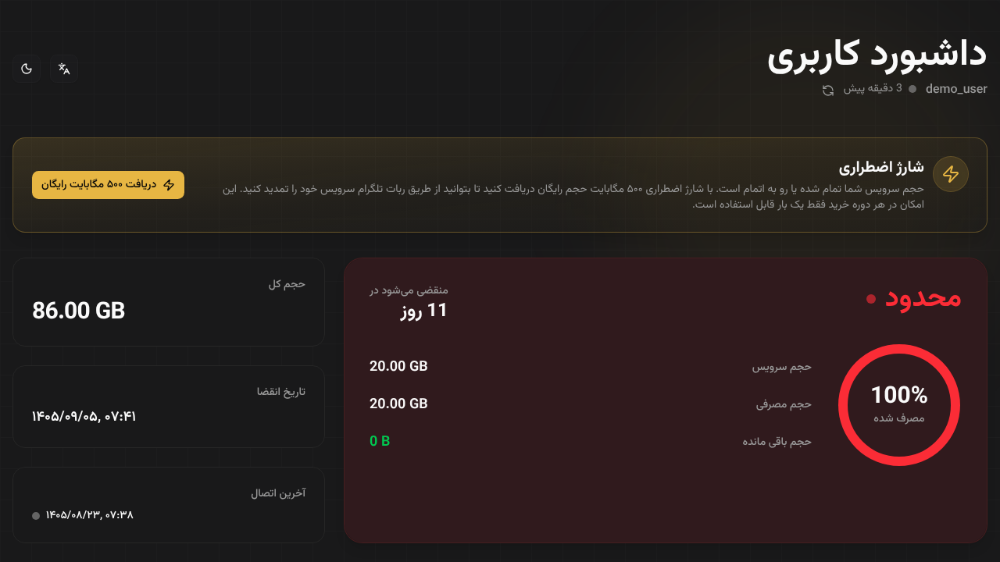
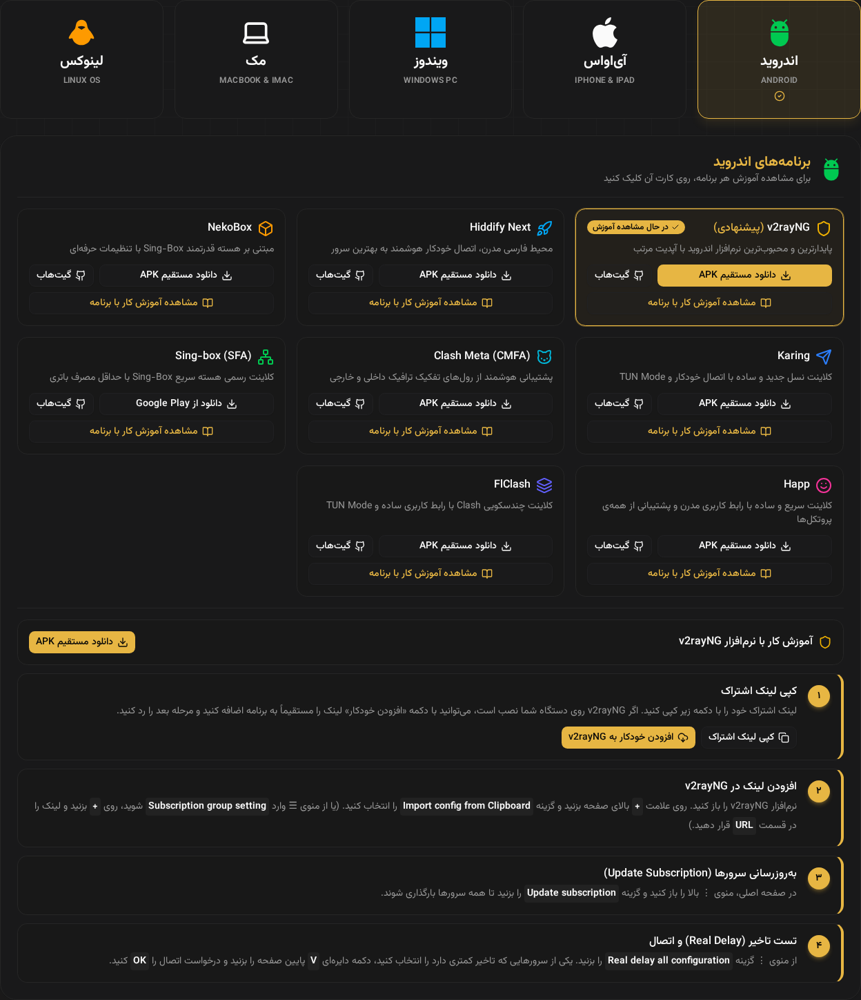
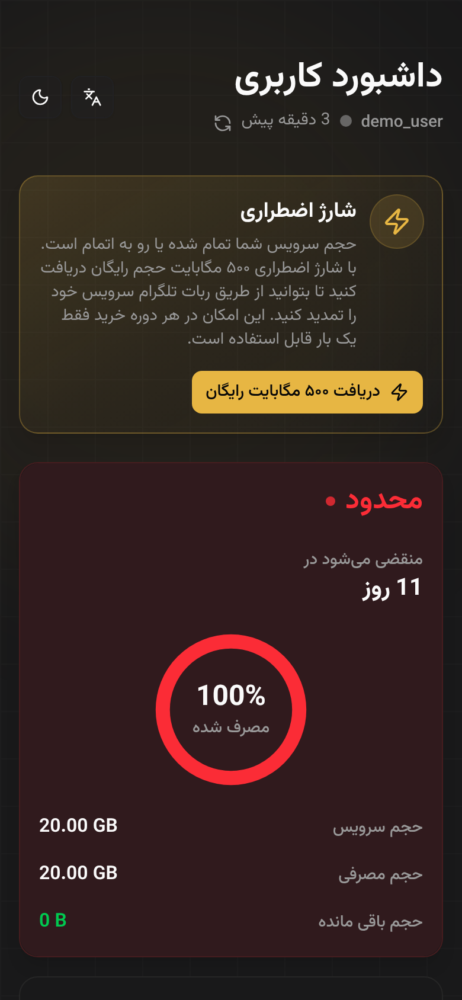

# قالب اشتراک PasarGuard با شارژ اضطراری و آموزش اتصال

این قالب، صفحه‌ی اشتراک واکنش‌گرا برای پنل [PasarGuard](https://github.com/PasarGuard/panel) است. بر پایه‌ی قالب رسمی [PasarGuard/subscription-template](https://github.com/PasarGuard/subscription-template) ساخته شده و این امکانات را اضافه می‌کند:

- **شارژ اضطراری:** کاربری که حجمش تمام شده، در هر دوره‌ی خرید یک بار حجم رایگان (پیش‌فرض ۵۰۰ مگابایت) دریافت می‌کند تا بتواند وارد ربات تلگرام شود و سرویسش را تمدید کند.
- **آموزش اتصال:** کاربر سیستم‌عامل خود (اندروید، آی‌اواس، ویندوز، مک، لینوکس) را انتخاب می‌کند. برای هر برنامه یک کارت با لینک دانلود و گیت‌هاب و آموزش مرحله‌به‌مرحله نمایش داده می‌شود.

<p align="center">
  
</p>
<p align="center">
  
  
</p>

**پیش‌نمایش تعاملی:** فایل [`preview/index.html`](preview/index.html) را دانلود کنید و در مرورگر باز کنید. اطلاعات آن نمونه است و سرویس شارژ در آن شبیه‌سازی شده است.

## فهرست

- [امکانات](#features)
- [سازگاری](#compatibility)
- [نصب](#install)
- [مهاجرت از قالب اصلی PasarGuard](#migrating)
- [شارژ اضطراری](#emergency-charge)
- [شخصی‌سازی](#customization)
- [به‌روزرسانی](#updating)
- [انتشار نسخه (برای صاحب مخزن)](#publishing)
- [حمایت مالی](#donate)

<a id="features"></a>

## امکانات

- زبان‌های `fa`، `en`، `ru` و `zh`، با امکان تغییر زبان توسط کاربر
- طراحی واکنش‌گرا و حالت تاریک
- کد QR برای لینک‌های اتصال
- کپی لینک و کانفیگ با یک کلیک. کپی Base64 فقط در مودال QR هست.
- لینک‌های WireGuard هم به صورت کانفیگ اصلی کپی می‌شوند و هم با فرمت `.conf` دانلود
- آموزش اتصال با دکمه‌ی «افزودن خودکار» برای برنامه‌هایی که از آن پشتیبانی می‌کنند (v2rayNG، Hiddify، Happ، Streisand، sing-box، Clash، FlClash)
- کارت شارژ اضطراری و دکمه‌ی «خرید از ربات تلگرام» (اختیاری؛ اسکریپت نصب راهش می‌اندازد)
- رنگ و گردی گوشه‌های قابل تنظیم

<a id="compatibility"></a>

## سازگاری

| نسخه‌ی قالب | نسخه‌ی پنل PasarGuard |
| --- | --- |
| `v2.x` (این مخزن) | `v3` |

<a id="install"></a>

## نصب

این دستور را روی سروری که PasarGuard روی آن نصب است اجرا کنید:

```sh
curl -fsSL https://raw.githubusercontent.com/imimz/subscription-template/main/install.sh | sudo bash -s -- --lang fa
```

اسکریپت چند سؤال می‌پرسد و بقیه‌ی کارها را خودش انجام می‌دهد:

۱. **رنگ صفحه:** `blue` (آبی، پیش‌فرض) یا `gold` (طلایی).

۲. **شارژ اضطراری نصب شود؟** اگر جواب بله باشد:
   - **لینک ربات تلگرام** برای دکمه‌ی «خرید» (اختیاری)
   - **رله یا CDN:** آیا کاربرها لینک اشتراک را از دامنه‌ی دیگری (مثلاً سرور ایران) باز می‌کنند؟ بخش [شارژ اضطراری](#emergency-charge) را ببینید.
   - **API Key پنل:** در پنل از بخش **API Keys** یک کلید بسازید. اسکریپت کلید را با پنل امتحان می‌کند و فقط روی همین سرور ذخیره‌اش می‌کند.

بعد از جواب دادن، اسکریپت:
- آخرین نسخه‌ی قالب را دانلود می‌کند و تنظیمات شما را داخلش می‌نویسد. نیازی به build روی سرور نیست.
- اگر شارژ اضطراری را انتخاب کرده باشید، سرویسش را نصب و اجرا می‌کند:
  - پورت پنل، گواهی SSL و مسیر اشتراک را خودش از `/opt/pasarguard/.env` پیدا می‌کند.
  - پورت را در `ufw` باز می‌کند.
  - هر روز سرویس را ری‌استارت می‌کند تا گواهی تمدیدشده را بخواند.
- از قالب فعلی نسخه‌ی پشتیبان `index.html.bak` می‌سازد.
- `CUSTOM_TEMPLATES_DIRECTORY` و `SUBSCRIPTION_PAGE_TEMPLATE` را در `/opt/pasarguard/.env` تنظیم می‌کند و پنل را ری‌استارت می‌کند.

حالا لینک اشتراک یکی از کاربران را در مرورگر باز کنید تا صفحه‌ی جدید را ببینید.

**پیش‌نیازها:**
- PasarGuard با اسکریپت رسمی نصب شده باشد (`/opt/pasarguard` و `/var/lib/pasarguard`).
- دسترسی root داشته باشید.
- برای شارژ اضطراری: پنل گواهی SSL داشته باشد و پورت `8765` از بیرون در دسترس باشد.

**گزینه‌ها:**

| گزینه | توضیح |
| --- | --- |
| `--lang en\|fa\|zh\|ru` | زبان پیش‌فرض صفحه (پیش‌فرض `fa`) |
| `--emergency-charge yes\|no` | بدون پرسیدن، شارژ اضطراری نصب شود یا نه |
| `--relay yes\|no` | کاربرها لینک را از دامنه‌ی رله یا CDN باز می‌کنند |
| `--telegram-bot <url>` | لینک ربات تلگرام روی کارت شارژ اضطراری |
| `--theme blue\|gold` | رنگ صفحه |
| `--charge-port <port>` | پورت سرویس شارژ اضطراری (پیش‌فرض `8765`) |
| `--version <tag>` | نصب یک نسخه‌ی مشخص (پیش‌فرض `latest`) |
| `--repo <owner>/<repo>` | نصب از یک مخزن دیگر |

برای نصب کاملاً بدون سؤال، API Key را در محیط بدهید:

```sh
curl -fsSL https://raw.githubusercontent.com/imimz/subscription-template/main/install.sh \
  | sudo PANEL_API_KEY=your-key bash -s -- --lang fa --emergency-charge yes --relay no --theme gold
```

<a id="migrating"></a>

## مهاجرت از قالب اصلی PasarGuard

همان [دستور نصب](#install) را اجرا کنید. اسکریپت از قالب فعلی نسخه‌ی پشتیبان می‌گیرد و از تنظیماتی که پنل از قبل دارد استفاده می‌کند.

**برای کاربران چه چیزی تغییر می‌کند؟**
- بخش «اپلیکیشن‌ها» جای خود را به «برنامه‌ها و آموزش اتصال» می‌دهد.
- لیست برنامه‌ها حالا داخل خود قالب (`src/constants/tutorials.ts`) تعریف می‌شود. برنامه‌هایی که در تنظیمات پنل (Subscription → Applications) وارد کرده‌اید دیگر در صفحه نمایش داده نمی‌شوند.
- بقیه‌ی بخش‌ها مثل قبل است: حجم، تاریخ انقضا، لینک کانفیگ‌ها، QR، نمودار مصرف و اعلان‌ها.

**بازگشت به قالب اصلی:**

```sh
sudo cp /var/lib/pasarguard/templates/subscription/index.html.bak \
        /var/lib/pasarguard/templates/subscription/index.html
pasarguard restart
```

یا قالب اصلی را دوباره با `--repo PasarGuard/subscription-template` نصب کنید.

<a id="emergency-charge"></a>

## شارژ اضطراری

کارت شارژ اضطراری برای کاربری نمایش داده می‌شود که وضعیتش `limited` است، منقضی شده، یا کمتر از ۵۰۰ مگابایت حجم دارد.
- با زدن دکمه، در هر دوره‌ی خرید یک بار ۵۰۰ مگابایت حجم رایگان می‌گیرد.
- کاربر منقضی‌شده علاوه بر حجم، ۲۴ ساعت اعتبار هم می‌گیرد.
- دوره‌ی جدید وقتی شروع می‌شود که سرویس تمدید شود، یعنی تاریخ انقضا یا حجم کل تغییر کند یا حجم مصرفی ریست شود.

صفحه‌ی اشتراک خودش نمی‌تواند حجم را تغییر دهد، چون این کار دسترسی ادمین می‌خواهد. این کار را یک سرویس کوچک در پوشه‌ی [`emergency-charge/`](emergency-charge/README.md) انجام می‌دهد. این سرویس کنار پنل اجرا می‌شود، کاربر را از روی توکن لینک اشتراکش شناسایی می‌کند و API Key فقط روی سرور می‌ماند. **اگر به سؤال شارژ اضطراری جواب «بله» بدهید، اسکریپت نصب همه‌ی این‌ها را خودش راه می‌اندازد.**

دو حالت دارد:

**۱. کاربرها لینک را مستقیم با دامنه‌ی پنل باز می‌کنند** (به سؤال رله جواب «نه» بدهید). صفحه، سرویس را روی همان دامنه و پورت `8765` صدا می‌زند.

**۲. کاربرها لینک را از طریق رله یا CDN باز می‌کنند** (به سؤال رله جواب «بله» بدهید). صفحه، آدرس `/emergency-charge` را روی دامنه‌ی رله صدا می‌زند و رله آن را به سرور پنل می‌فرستد. اسکریپت در پایان دقیقاً همان خطی را که باید روی رله اضافه کنید چاپ می‌کند. برای [sub-forward-proxy](https://github.com/imimz/sub-forward-proxy) این شکلی است:

```php
'routes' => ['#^/emergency-charge/?$#' => 'https://PANEL-IP:8765'],
```

بعد از اضافه کردن این خط، `systemctl restart rh-subproxy` را بزنید.

برای تغییر هر تنظیمی در آینده (خاموش کردن، عوض کردن لینک ربات یا API Key)، اسکریپت نصب را دوباره اجرا کنید. نصب دستی و همه‌ی تنظیمات سرویس در [emergency-charge/README.md](emergency-charge/README.md) توضیح داده شده است.

<a id="customization"></a>

## شخصی‌سازی

**برنامه‌ها و آموزش‌ها:**
- برای اضافه یا حذف کردن برنامه، تغییر لینک دانلود یا ویرایش مراحل آموزش، فایل [`src/constants/tutorials.ts`](src/constants/tutorials.ts) را ویرایش کنید و بعد قالب را [از سورس build کنید](#build-from-source).
- متن‌ها به فارسی و انگلیسی هستند و زبان‌های دیگر از متن انگلیسی استفاده می‌کنند.
- اسم دکمه‌ها و منوها را داخل backtick بنویسید (مثلاً `` `Update subscription` ``) تا برجسته نمایش داده شوند.

**رنگ و اندازه‌های دیگر:** این مقادیر هنگام build از `.env` خوانده می‌شوند (نمونه در [`.env.example`](.env.example)):

| متغیر | توضیح |
| --- | --- |
| `VITE_FALLBACK_LANGUAGE` | زبان پیش‌فرض: `fa`، `en`، `ru` یا `zh` |
| `VITE_PRIMARY_COLOR_LIGHT` / `VITE_PRIMARY_COLOR_DARK` | رنگ اصلی در تم روشن و تیره |
| `VITE_BORDER_RADIUS` | گردی گوشه‌ها، مثلاً `0.65rem` |

تنظیماتی که اسکریپت نصب می‌نویسد (رنگ، شارژ اضطراری و ربات تلگرام) بر این مقادیر اولویت دارند.

<a id="build-from-source"></a>

### ساخت از سورس

```sh
sudo apt update && sudo apt install -y unzip git
curl -fsSL https://bun.sh/install | bash
export PATH="$HOME/.bun/bin:$PATH"

git clone https://github.com/imimz/subscription-template.git
cd subscription-template
cp .env.example .env && nano .env
bun install && bun run build
sudo cp dist/index.html /var/lib/pasarguard/templates/subscription/index.html
```

اگر رم سرور کم باشد، ممکن است build وسط کار متوقف شود (`Killed`). در این صورت قبل از build یک swap بسازید:

```sh
fallocate -l 2G /swapfile && chmod 600 /swapfile && mkswap /swapfile && swapon /swapfile
```

<a id="updating"></a>

## به‌روزرسانی

[دستور نصب](#install) را دوباره اجرا کنید. اسکریپت جواب‌های قبلی و API Key را به خاطر دارد، پس دوباره سؤال نمی‌پرسد. هم صفحه و هم سرویس شارژ اضطراری را به‌روز می‌کند.

<a id="publishing"></a>

## انتشار نسخه (برای صاحب مخزن)

با انتشار هر Release، یک GitHub Actions برای هر زبان یک فایل می‌سازد و آن‌ها را به Release اضافه می‌کند. اسکریپت نصب همین فایل‌ها را دانلود می‌کند.

۱. به **Releases → Draft a new release** بروید، یک تگ جدید (مثلاً `v2.4.0`) بسازید و **Publish release** را بزنید.

۲. صبر کنید تا workflow با نام **Release** در تب **Actions** تمام شود. بعد از آن، Release شامل `index.html` (پیش‌فرض فارسی) و `en.html`، `fa.html`، `ru.html` و `zh.html` است.

**نکته‌ها:**
- در مخزن fork‌شده، اول تب **Actions** را باز کنید و آن را فعال کنید.
- `VITE_EMERGENCY_CHARGE_URL` و `VITE_TELEGRAM_BOT_URL` را در Variables مخزن نگذارید، چون هر چیزی که آنجا باشد داخل فایلی می‌رود که همه دانلود می‌کنند.

## زبان‌های دیگر

- [English](README.md)
- [Русский (Russian)](README.ru.md)
- [中文 (Chinese)](README.zh.md)

## منبع

بر پایه‌ی [PasarGuard/subscription-template](https://github.com/PasarGuard/subscription-template) از تیم PasarGuard.

<a id="donate"></a>

## حمایت مالی

اگر این پروژه برایتان مفید بوده، می‌توانید با TON از آن حمایت کنید:

```
UQAlKB5FgfqF1Wq3o0J9x6DrXjJRx0nBt5DtU-rfbcDQNCsp
```
