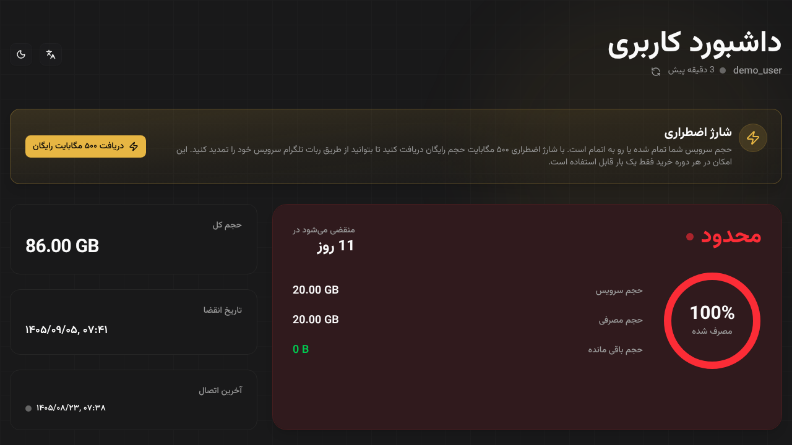
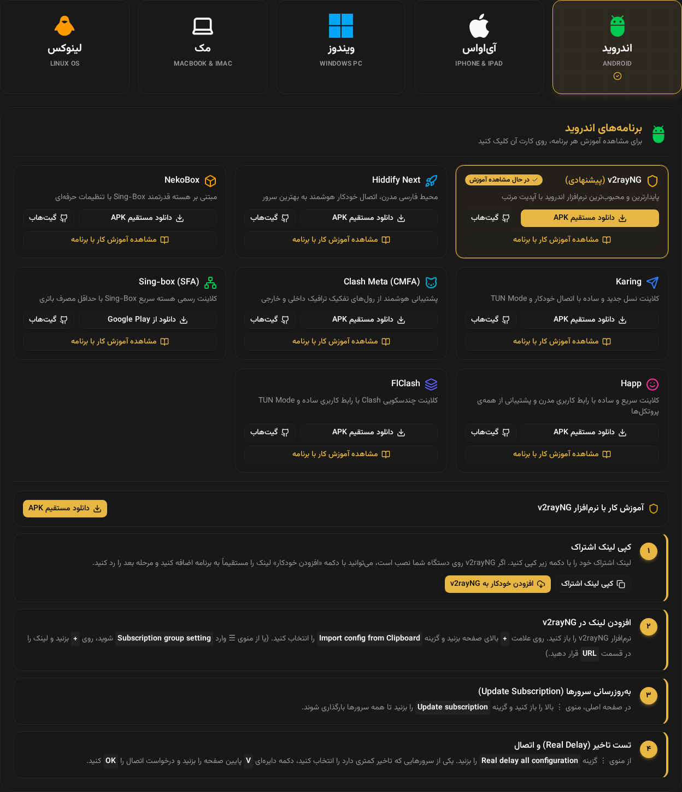
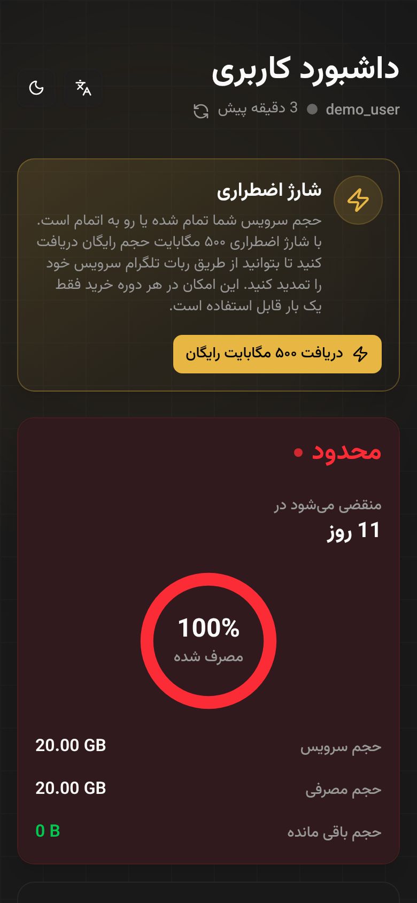

# Subscription Template (PasarGuard) with Emergency Charge & Setup Guide

A responsive subscription page for the [PasarGuard](https://github.com/PasarGuard/panel) panel. It is based on the official [PasarGuard/subscription-template](https://github.com/PasarGuard/subscription-template) and adds:

- **Emergency charge**: a user who is out of traffic can claim free traffic (500 MB by default) once per purchase period, so they can reach your Telegram bot and renew.
- **Setup guide**: pick a platform (Android, iOS, Windows, macOS, Linux) and get app cards with download and GitHub links, plus step-by-step setup tutorials.

<p align="center">
  
</p>
<p align="center">
  
  
</p>

**Interactive demo:** download [`preview/index.html`](preview/index.html) and open it in a browser. It uses sample data and a simulated charge service.

## Contents

- [Features](#features)
- [Compatibility](#compatibility)
- [Install](#install)
- [Migrating from the original PasarGuard template](#migrating)
- [Emergency charge](#emergency-charge)
- [Customization](#customization)
- [Updating](#updating)
- [Publishing a release (repository owner)](#publishing)
- [Donate](#donate)

## Features

- Languages: `en`, `fa`, `zh`, `ru`, which users can switch in the UI
- Responsive layout and dark mode
- QR code for connection links
- One-click copy for links and configs; Base64 copy is only in the QR modal
- WireGuard links can be copied as a native config or downloaded as `.conf`
- Setup guide with one-tap import buttons for apps that support deep links (v2rayNG, Hiddify, Happ, Streisand, sing-box, Clash, FlClash)
- Emergency charge card with a "buy from Telegram bot" button (optional), set up by the installer
- Custom colors and border radius

## Compatibility

| Subscription Template | PasarGuard Panel |
| --- | --- |
| `v2.x` (this repository) | `v3` |

<a id="install"></a>

## Install

Run this on the server where PasarGuard is installed:

```sh
curl -fsSL https://raw.githubusercontent.com/imimz/subscription-template/main/install.sh | sudo bash -s -- --lang fa
```

The installer asks a few questions and does the rest itself:

1. **Page color**: `blue` (default) or `gold`.
2. **Set up emergency charge?** If yes:
   - **Telegram bot link** for the "buy" button (optional).
   - **Relay or CDN?** Do users open subscription links through another domain, such as an Iran server? See [Emergency charge](#emergency-charge).
   - **Panel API key**: create one in the panel under **API Keys**. It's checked against the panel and stored only on this server.

Then it:
- downloads the latest release and writes your settings into it (nothing is built on the server)
- installs and starts the emergency charge service, if you chose it: it finds the panel's port, SSL certificate and subscription path in `/opt/pasarguard/.env`, opens the port in `ufw`, and restarts the service daily so it picks up renewed certificates
- backs up the current template to `index.html.bak`
- sets `CUSTOM_TEMPLATES_DIRECTORY` and `SUBSCRIPTION_PAGE_TEMPLATE` in `/opt/pasarguard/.env`, and restarts the panel

Open any user's subscription link in a browser to see the new page.

**Requirements:** PasarGuard installed with its official script (`/opt/pasarguard`, `/var/lib/pasarguard`), root access, and for emergency charge an SSL certificate on the panel and port `8765` reachable.

**Options:**

| Option | Description |
| --- | --- |
| `--lang en\|fa\|zh\|ru` | Default language of the page (default `fa`) |
| `--emergency-charge yes\|no` | Skip the question |
| `--relay yes\|no` | Users open links through a relay/CDN domain |
| `--telegram-bot <url>` | Telegram bot link for the emergency charge card |
| `--theme blue\|gold` | Page color |
| `--charge-port <port>` | Port of the emergency charge service (default `8765`) |
| `--version <tag>` | Install a specific release (default `latest`) |
| `--repo <owner>/<repo>` | Install from another repository |

For a fully non-interactive install, pass the API key in the environment:

```sh
curl -fsSL https://raw.githubusercontent.com/imimz/subscription-template/main/install.sh \
  | sudo PANEL_API_KEY=your-key bash -s -- --lang fa --emergency-charge yes --relay no --theme gold
```

<a id="migrating"></a>

## Migrating from the original PasarGuard template

Run the [install command](#install). It keeps a backup of your current template and reuses the panel settings that are already there.

What changes for your users:
- The **Apps** section is replaced by the **Apps & setup guide** section. Apps are now defined in the template (`src/constants/tutorials.ts`) instead of the panel's *Subscription → Applications* settings. Those panel settings are no longer shown on the page.
- Everything else stays the same: usage, expiry, config links, QR codes, the chart and announcements.

**Going back to the original template:**

```sh
sudo cp /var/lib/pasarguard/templates/subscription/index.html.bak \
        /var/lib/pasarguard/templates/subscription/index.html
pasarguard restart
```

Or install the original again with `--repo PasarGuard/subscription-template`.

<a id="emergency-charge"></a>

## Emergency Charge

When a user is `limited`, expired, or has less than 500 MB left, the page shows an emergency charge card. The button adds 500 MB once per purchase period; expired users also get 24 hours of validity. A new period starts when the subscription is renewed: the expire date or data limit changes, or usage is reset.

The page can't change a data limit by itself, because that needs admin access. A small service in [`emergency-charge/`](emergency-charge/README.md) does it. It runs next to the panel, checks the user through their subscription token, and keeps the API key on the server. **The installer sets all of this up** when you answer "yes".

- **Users open links directly on the panel's domain** (answer "no" to the relay question): the page calls the service on the same domain, port `8765`.
- **Users open links through a relay or CDN** (answer "yes"): the page calls `/emergency-charge` on the relay's domain, and the relay forwards it to the panel server. At the end, the installer prints the exact line to add on the relay. For [sub-forward-proxy](https://github.com/imimz/sub-forward-proxy) it looks like this:

  ```php
  'routes' => ['#^/emergency-charge/?$#' => 'https://PANEL-IP:8765'],
  ```

  After adding it, run `systemctl restart rh-subproxy`.

To change anything later (turn it off, change the bot link or the API key), run the installer again. Manual setup and every option of the service are described in [emergency-charge/README.md](emergency-charge/README.md).

<a id="customization"></a>

## Customization

**Apps and tutorials:** edit [`src/constants/tutorials.ts`](src/constants/tutorials.ts) to add or remove apps, change download links, or rewrite the steps. Text is written in Persian and English; other languages fall back to English. Wrap button and menu names in backticks (`` `Update subscription` ``) to highlight them. Then [build from source](#build-from-source).

**Other colors and sizes:** these come from `.env` at build time (see [`.env.example`](.env.example)):

| Variable | Description |
| --- | --- |
| `VITE_FALLBACK_LANGUAGE` | Default language: `en`, `fa`, `zh`, `ru` |
| `VITE_PRIMARY_COLOR_LIGHT` / `VITE_PRIMARY_COLOR_DARK` | Main color for the light and dark themes |
| `VITE_BORDER_RADIUS` | Corner radius, for example `0.65rem` |

Settings written by the installer (theme, emergency charge, Telegram bot) take priority over these.

<a id="build-from-source"></a>

### Build from source

```sh
sudo apt update && sudo apt install -y unzip git
curl -fsSL https://bun.sh/install | bash
export PATH="$HOME/.bun/bin:$PATH"

git clone https://github.com/imimz/subscription-template.git
cd subscription-template
cp .env.example .env && nano .env
bun install && bun run build
sudo cp dist/index.html /var/lib/pasarguard/templates/subscription/index.html
```

On servers with little memory, the build can be killed; add swap first (`fallocate -l 2G /swapfile && chmod 600 /swapfile && mkswap /swapfile && swapon /swapfile`).

<a id="updating"></a>

## Updating

Run the [install command](#install) again. It remembers your previous answers and API key, so it doesn't ask again, and it updates both the page and the emergency charge service.

<a id="publishing"></a>

## Publishing a release (repository owner)

A GitHub Actions workflow builds one file per language and attaches them to every published release. The installer downloads those files.

1. Go to **Releases → Draft a new release**, create a new tag (for example `v2.4.0`), and click **Publish release**.
2. Wait for the **Release** workflow in the **Actions** tab to finish. The release then contains `index.html` (Persian default) and `en.html`, `fa.html`, `ru.html`, `zh.html`.

On a fork, enable Actions first: open the **Actions** tab and confirm. Don't put `VITE_EMERGENCY_CHARGE_URL` or `VITE_TELEGRAM_BOT_URL` in the repository variables: everything there ends up in the files everyone downloads.

## Other Languages

- [فارسی (Persian)](README.fa.md)
- [Русский (Russian)](README.ru.md)
- [中文 (Chinese)](README.zh.md)

## Credits

Based on [PasarGuard/subscription-template](https://github.com/PasarGuard/subscription-template) by the PasarGuard team.

<a id="donate"></a>

## Donate

If this project is useful to you, you can support it with TON:

```
UQAlKB5FgfqF1Wq3o0J9x6DrXjJRx0nBt5DtU-rfbcDQNCsp
```
